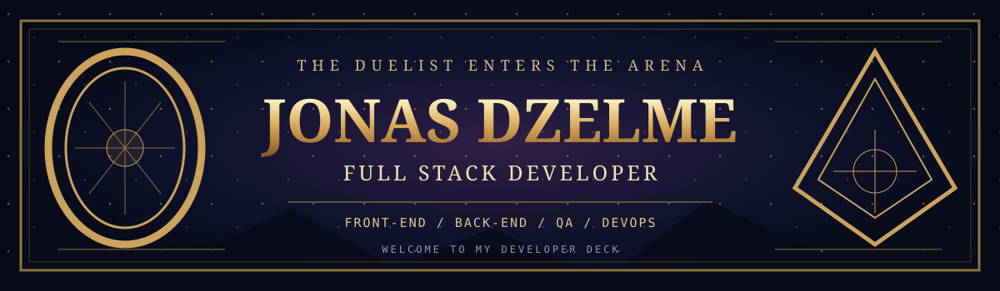
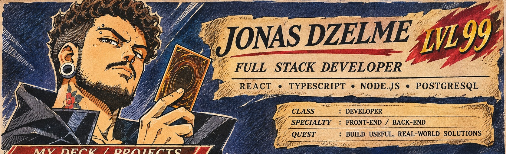
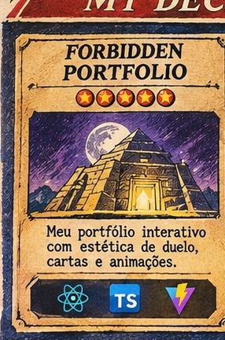
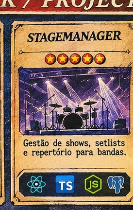
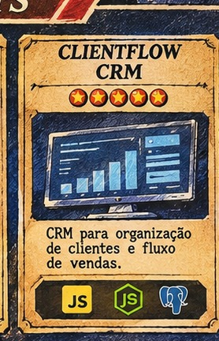
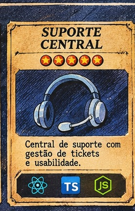
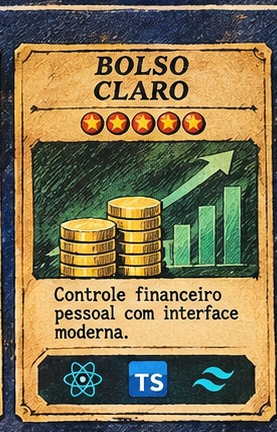
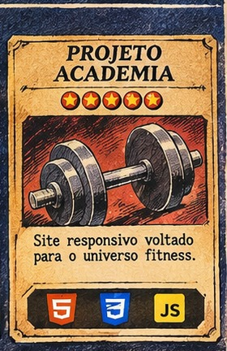

---

### ✦ CHARACTER PROFILE `01 / ABOUT ME`

I'm **Jonas Dzelme**, a developer based in **Rio de Janeiro, Brazil**. I enjoy turning ideas into interfaces and applications that people can actually use — from responsive front-ends to APIs and database integrations.

I work primarily with **React, TypeScript, Node.js and PostgreSQL**. I'm currently looking for **internship and junior opportunities** in software development, QA and related technical roles.

> My approach is simple: understand the problem, build something useful, test it, and keep improving.

### ⚔ MY DECK `02 / TECH STACK`

> **DECK CONFIGURATION** — The tools I use to build interfaces, connect services and work with data.

**FRONT-END**

**BACK-END & DATABASES**

**TOOLS & WORKFLOW**

### ✦ MY PROJECT DECK `03 / SIX CARDS`

<table>
<tr><td align="center" width="33%"> <a href="https://portfolio-jonas-dzelme.vercel.app/"><b>Forbidden Portfolio</b></a></td><td align="center" width="33%"> <a href="https://github.com/Dzelmee?tab=repositories&q=StageManager"><b>StageManager</b></a></td><td align="center" width="33%"> <a href="https://github.com/Dzelmee/ClientFlow-CRM"><b>ClientFlow CRM</b></a></td></tr>
<tr><td align="center" width="33%"> <a href="https://github.com/Dzelmee?tab=repositories&q=suporte-central"><b>Suporte Central</b></a></td><td align="center" width="33%"> <a href="https://github.com/Dzelmee?tab=repositories&q=bolso-claro"><b>Bolso Claro</b></a></td><td align="center" width="33%"> <a href="https://github.com/Dzelmee/projeto-academia"><b>Projeto Academia</b></a></td></tr>
</table>

Choose a card to explore the project.

### 🃏 DRAW PHASE `04 / THE CODE DUELIST`

**DRAW A CARD · BUILD A FEATURE · TEST THE RESULT**  
*An original animated card-draw scene, inspired by classic dueling games.*

### ✉ CONTACT `05 / NEXT QUEST`

I'm open to conversations about software development, projects and junior opportunities. You can find me on [LinkedIn](https://www.linkedin.com/in/jonas-dzelme/) or reach me at **[JonasDzelme@gmail.com](mailto:JonasDzelme@gmail.com)**.

THE DEVELOPER'S DECK · JONAS DZELME

